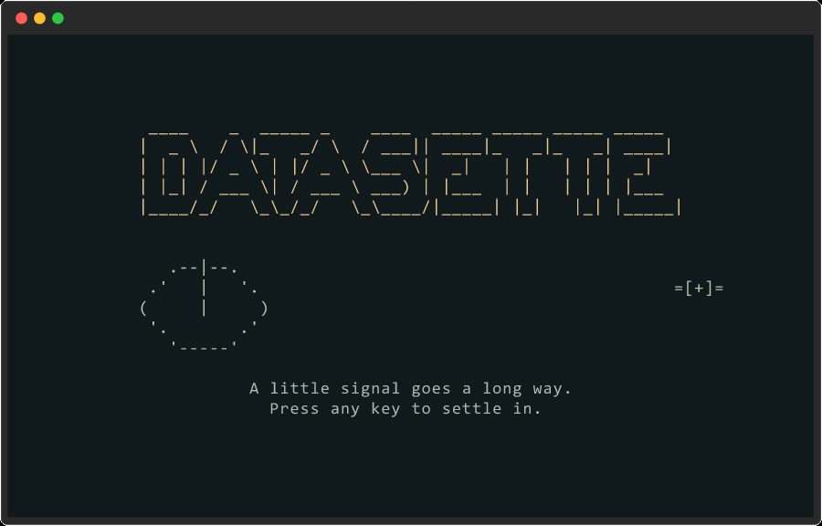
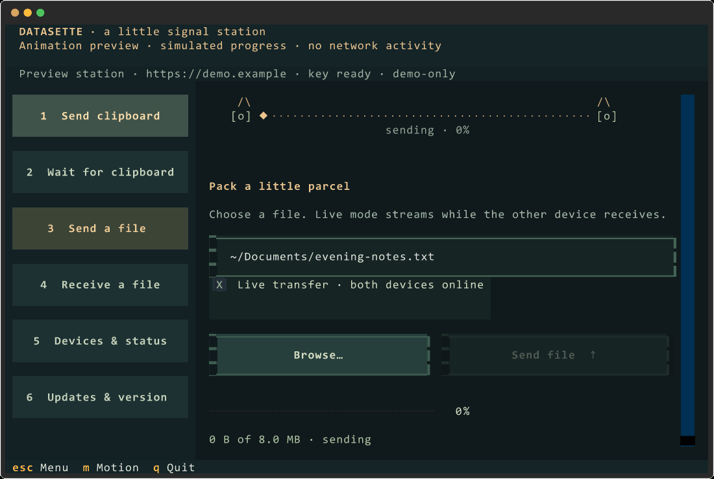

# Datasette

A little terminal signal station for sending files and clipboard notes between your own devices.

Datasette uses a cozy, resizable Textual interface: amber lights, sage green signals, animated parcels between stations, and a skippable satellite/radar boot sequence. It supports desktop terminals and compact phone terminals down to **36 columns × 18 rows**.





The Python package is **dsette**, the client is **dset**, and the server/admin command is **dsetd**. This project is unrelated to Simon Willison's Datasette database application.

## Quick start

```bash
git clone https://github.com/YOUR_ACCOUNT/dsette.git
cd dsette
./run.sh
```

On Windows use `run.cmd` instead; on macOS double-click `run.command`. The following launcher handles setup and future updates for you.

**One-command launcher:** after cloning, use `./run.sh` on Linux/WSL, double-click `run.command` on macOS, or run `run.cmd` on Windows (also from PowerShell). The launcher supports Python 3.9+ as a bootstrap and installs an isolated Python 3.12 runtime if needed; Git/OpenSSH must be installed. On Ubuntu/Debian the Python bootstrap also needs `python3-venv`. It reuses compatible existing `.venv312`/`.venv` installations. It never replaces system Python or deletes your device identity.

The launcher checks for signed updates on startup (at most once per ten minutes) and applies them automatically. A new release and hash-locked dependencies are installed and smoke-tested in a separate environment **before** the checkout advances. Updates require trusted signatures and fast-forward history; local edits are preserved and cause a clear skip/refusal. If an automatic check fails or you are offline, an installed client still starts. First installation requires internet access.

| OS | Launch (automatic updates) | Force an update now |
| --- | --- | --- |
| Linux / Ubuntu WSL | `./run.sh` | `./update.sh` |
| macOS | `./run.command` | `./update.command` |
| Windows cmd / PowerShell | `.\run.cmd` | `.\update.cmd` |

Use `./run.sh --no-update` or `DSETTE_AUTO_UPDATE=0 ./run.sh` to skip the automatic online check (Windows: `run.cmd --no-update`). Client arguments are forwarded, for example `./run.sh --no-animation`. After the initial bootstrap you need only the launch command, not Python or virtual-environment commands. Existing enrolled devices do not enroll again. Machines on an older checkout need one `git pull --ff-only` to obtain these scripts.

Update environments are cached in ignored `.dsette-runtime/` folders, retaining prior installations for recovery. The public signing-key pin and per-checkout check timestamps live in the separate OS configuration folder `dsette-launcher`; it contains no device keys or session tokens. Old cached environments are not automatically deleted while other client instances may use them.

## Manual installation (optional)

The manual route below requires Python **3.11+** on Windows, macOS, Linux, or a Python-capable phone terminal such as Termux. Use the launcher above to avoid these environment commands.

```bash
git clone https://github.com/YOUR_ACCOUNT/dsette.git
cd dsette
python -m venv .venv
# Linux/macOS:
. .venv/bin/activate
# Windows PowerShell instead:
# .\.venv\Scripts\Activate.ps1
python -m pip install .
dset enroll https://YOUR_SERVER --name laptop
dset
```

Enrollment prompts for a one-time invitation without echoing it. Every device creates its own Ed25519 private key in its OS configuration directory, outside the checkout. You may encrypt it with a passphrase using `dset enroll --encrypt-key`. Never copy a device key through Git or paste it into chat.

The server owner creates invitations with `dsetd invite`. An invitation expires after ten minutes and works once. The first enrolled device is an administrator. Other devices can share files without being administrators.

Public code does not make a server public to unauthenticated users: enrollment and a device's private key are required to access payloads. Only the HTTPS health endpoint is intentionally public.

## A cozy keyboard interface

Run `dset` or `dset tui`. Use Tab/Shift-Tab and Enter, or these menu shortcuts:

| Key | Station |
| --- | --- |
| 1 | Send clipboard |
| 2 | Listen for clipboard, preview, copy when you choose |
| 3 | Send a file: live relay or stored inbox |
| 4 | Receive a file: discover live senders or browse the inbox |
| 5 | Device and connection status |
| 6 | Versions and signed updates |
| Esc | Return to menu |
| m | Toggle motion |
| q | Quit |

The startup animation skips on any key. Use `dset --no-animation` or `DSETTE_REDUCED_MOTION=1` for reduced motion; `NO_COLOR` disables color. Narrow layouts stack navigation and use scrollable forms. Progress reflects transferred bytes; verification is reported separately.

Keyboard: Tab/Shift-Tab always move between controls, arrows navigate file lists, and Enter selects/activates. Esc returns focus to the menu; use 1–6 there, or Alt+1–6 from any field. F5 (or Ctrl+R) refreshes the receiving shelf/status. The active page and keyboard focus have different styling.

The receiving shelf checks automatically every two seconds and includes live senders plus stored inbox files. You do not need to keep pressing Refresh. A **LIVE · waiting** entry begins relaying/downloading only after you select it, choose a save path, and activate Receive. An **INBOX · ready** entry has already uploaded and passed server verification. New arrivals preserve your selection and edited save path. Tab from the save path goes directly to Receive.

To update an already enrolled computer, quit the app, run `git pull --ff-only` in its checkout, then reinstall with that environment's Python (`python -m pip install .`). Device identity is stored outside the checkout and survives reinstall; no new invitation is needed. If uv created an environment without pip, use `uv pip install --python PATH_TO_ENV_PYTHON .` instead.

## Transfer modes

**Live:** both devices are online. A sender hashes the file, announces it, and waits for a receiver to join. Bytes flow through a bounded 2 MiB server queue with backpressure, without a server-side file copy. The receiver checks size, SHA-256, and sender completion before publishing the local file. Idle peers time out after two minutes. An interrupted live relay must restart.

```bash
dset live-send ./large-file
# The receiver can discover it in the TUI, or use the printed ID:
dset live-receive TRANSFER_ID ./received-file
```

**Inbox:** the receiver can be offline. Chunk offsets survive client/network/service interruption. The server verifies the upload, and the receiver resumes with HTTP Range and verifies again. Downloading never silently overwrites an existing file.

```bash
dset send ./file.zip
dset inbox
dset receive TRANSFER_ID ./received.zip
dset push
dset pull
dset watch
```

Use `dset --help` for available command options. Linux clipboards can use Wayland wl-clipboard or X11 xclip/xsel; macOS, Windows, and Termux have native command fallbacks. A headless server may have no local clipboard.

## Run your own server

Use a separate directory and service account. The included Oracle/Ubuntu installer operates under `/opt/dsette` and `/var/lib/dsette`, with one Uvicorn worker and a hardened systemd unit. It does not change an existing application's ports.

```bash
# After copying/cloning this source to /opt/dsette:
sudo bash /opt/dsette/deploy/install-oracle.sh
# If nginx is already installed and your DNS points at the VM:
sudo python3 /opt/dsette/deploy/configure-nginx.py YOUR_HOSTNAME
```

The nginx helper adds its own hostname-based virtual host and obtains a Let's Encrypt certificate. It streams requests and responses without proxy buffering. A Caddy example is included for servers using Caddy instead. Only expose HTTPS at your chosen public port; backend 8223 stays on loopback. See `deploy/firewall.md`.

Without a domain, keep the loopback TLS service behind an SSH tunnel or provision a self-signed certificate with the correct IP/DNS Subject Alternative Name. Enrollment supports `--ca-cert FILE` or `--fingerprint SHA256`; compare the fingerprint with trusted server-admin output. Never disable certificate verification.

```bash
sudo -u dsette env DSETTE_DATA_DIR=/var/lib/dsette /opt/dsette/.venv/bin/dsetd invite
sudo -u dsette env DSETTE_DATA_DIR=/var/lib/dsette /opt/dsette/.venv/bin/dsetd list-devices
sudo -u dsette env DSETTE_DATA_DIR=/var/lib/dsette /opt/dsette/.venv/bin/dsetd revoke DEVICE_ID
sudo -u dsette env DSETTE_DATA_DIR=/var/lib/dsette /opt/dsette/.venv/bin/dsetd inbox
sudo -u dsette env DSETTE_DATA_DIR=/var/lib/dsette /opt/dsette/.venv/bin/dsetd purge
```

`dsetd tui` provides a server-side inbox/directory picker with placement confirmation. `dsetd place ID DIRECTORY [--rename NAME]` restricts destinations to `DSETTE_ALLOWED_ROOTS`, resolves symlinks, refuses overwrites without `--force`, and sets mode 0644. Put allowed roots in the service environment; defaults should be chosen for your own host.

Configure `DSETTE_MAX_FILE_SIZE` (default 2 GiB) and `DSETTE_DEVICE_QUOTA` (default 4 GiB) as needed. Expired clipboard items and stale unfinished uploads are purged; inbox files remain until explicitly placed or deleted.

## Keys, privacy, and trust

TLS protects connections. Device keys remain local; the server stores public keys, hashed invitations/sessions, and audit metadata. Clipboard content is not logged and expires after ten minutes by default. Private directories are mode 0700 and private files mode 0600 on Unix; Windows uses protected owner-only ACLs. Revoking a device invalidates its sessions.

The server can read relayed bytes and stored payloads. **End-to-end payload encryption is a future, optional v2 feature**, not a property of this v1. Encrypted private keys protect keys at rest, not files on a compromised device. A device you enroll gains access to your shared clipboard/inbox; revoke temporary or lost devices promptly.

Source code, public signer keys, and generic deployment templates can be public. Device private keys, invitation tokens, session tokens, TLS private keys, deployment credentials, and private operational notes must remain outside the repository. See `SECURITY.md`.

## Verified updates

Updates require a configured remote/branch, a signed target commit from an explicitly trusted signer, and a fast-forward history. Verification fails closed. The server stages a fresh release with hash-pinned dependencies, runs tests/smoke checks, backs up SQLite, switches releases, restarts only its own unit, and rolls back on failed health checks.

The separate update supervisor runs as an unprivileged user. If enabled, exact systemd start/stop/restart permissions apply only to Datasette. See `deploy/updater-systemd.md`; updates stay disabled until trust and the source repository are configured.

`dsetd update` or an admin-device TUI/API request queues an update. Admin logins can check for updates at most once every ten minutes. Candidate advertisement does not bypass signature verification at installation. Client source updates likewise verify signed, fast-forward commits; configure a trusted signers file before using `dset self-update`.

## Development and checks

```bash
python -m pip install -e '.[dev]'
python -m pytest -q
python scripts/acceptance_large.py --size-mib 1024
```

The optional large-file acceptance creates a disposable TLS server, interrupts/restarts a 1 GiB upload, resumes upload/download, verifies SHA-256, and measures server memory on Linux. It needs several GiB of temporary disk space and does not touch a running production service.

`requirements.lock` pins cross-platform dependency versions and hashes. Install it with `pip install --require-hashes -r requirements.lock`, then `pip install --no-deps .`. Optional development snapshots and private run notes are excluded from release exports.

## License

The source is public for inspection. **All rights reserved; no open-source reuse license has been granted.** See LICENSE.

